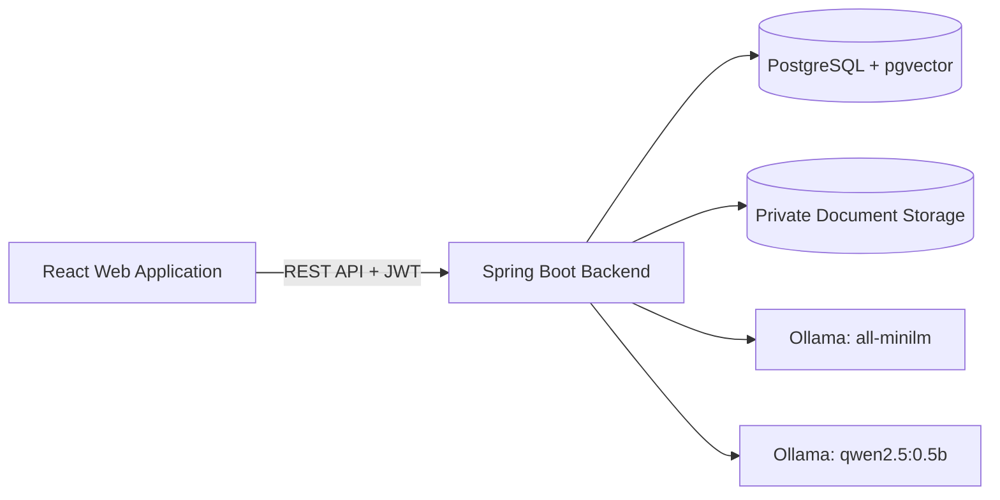

# Intelligent Document Analytics Hub

**DocumentHub** is a full-stack web application for managing documents and finding information using semantic search and AI-powered question answering. Users can upload private documents, process their contents, and ask questions with supporting passages from their own files.

The application runs locally with **React, Spring Boot, PostgreSQL, pgvector, and Ollama**.

## Features

- **Secure accounts:** Registration, login, JWT authentication, and document ownership checks.
- **Document management:** Upload, view, search, filter, sort, rename, and delete personal documents.
- **File support:** PDF, DOCX, and TXT files, up to **10 MB per file**.
- **Document processing:** Extract text, split it into chunks, and generate vector embeddings.
- **Semantic search:** Find relevant passages using similarity rather than exact keywords alone.
- **Ask AI:** Generate answers from retrieved document passages and view the supporting sources.
- **Dashboard:** View document counts, processing status, and recent documents.
- **Modern interface:** Responsive layouts, light/dark/system themes, and accessible feedback states.

Document processing is performed through explicit steps: **Upload → Extract → Chunk → Embed → Search / Ask AI**.

## Technology Stack

| Layer | Technologies |
| --- | --- |
| Frontend | React 19, Vite 8, React Router, JavaScript, CSS |
| Backend | Java 21, Spring Boot 4.1.2, Maven, REST API |
| Database | PostgreSQL, pgvector, Spring Data JPA/JDBC, Flyway |
| AI | Ollama `all-minilm` (384-dimensional embeddings), `qwen2.5:0.5b` (answer generation) |
| Document extraction | Apache PDFBox, Apache POI |
| Authentication | Spring Security, JWT, BCrypt |

## System Architecture



### How RAG Works

1. The user uploads a document and extracts its text.
2. The backend divides the text into smaller overlapping chunks.
3. Ollama generates embeddings, which are saved in PostgreSQL with pgvector.
4. A user's question is converted into an embedding to retrieve relevant chunks from an owned document.
5. The retrieved text is provided to the local language model to generate an answer.
6. The UI displays the answer together with the retrieved source passages.

AI answers can be incomplete or incorrect. Source passages help users check the information.

## Project Structure

```text
Intelligent-Document-Analytics-Hub/
├── backend/
│   ├── src/main/java/          # Spring Boot controllers, services, entities, repositories
│   ├── src/main/resources/     # Configuration and Flyway migrations
│   ├── src/test/               # Backend tests
│   ├── pom.xml
│   └── mvnw.cmd
├── frontend/
│   ├── public/images/         # Authentication-page illustrations
│   ├── src/components/        # Reusable UI, semantic search, and Ask AI
│   ├── src/context/           # Authentication and theme state
│   ├── src/pages/             # Home, Login, Register, Dashboard, Documents
│   ├── src/styles/            # Shared styling
│   └── package.json
├── docs/                       # Setup, architecture, and API documentation
└── README.md
```

## Local Setup (Windows)

### Prerequisites

- **JDK 21** or a compatible newer JDK
- **Node.js** compatible with Vite 8 (Node 20.19+ or 22.12+)
- **PostgreSQL** with the **pgvector** extension installed
- **Ollama** installed and available locally

### 1. Clone the project

```powershell
git clone https://github.com/sameeramadhushan2003-del/Intelligent-Document-Analytics-Hub.git
cd Intelligent-Document-Analytics-Hub
```

### 2. Configure PostgreSQL

The default application configuration expects:

| Setting | Default |
| --- | --- |
| Database | `document_analytics_hub` |
| Application role | `document_hub_app` |
| PostgreSQL port | `5432` |

Create the database and authorized role if setting up a new installation. Install pgvector on the PostgreSQL server and enable the `vector` extension using an appropriately privileged PostgreSQL account. **Flyway runs the project's schema migrations automatically** when the backend starts. Do not reset an existing database.

### 3. Download the AI models

```powershell
ollama pull all-minilm
ollama pull qwen2.5:0.5b
```

Start Ollama if it is not already running (for example, open the Ollama app or use `ollama serve` in a separate terminal).

### 4. Set backend environment variables

The backend requires the following **private** environment variables:

| Variable | Purpose |
| --- | --- |
| `DB_PASSWORD` | Password for the PostgreSQL application role |
| `JWT_SECRET_BASE64` | Stable Base64-encoded JWT signing key (at least 32 decoded bytes) |
| `OLLAMA_BASE_URL` | Optional; defaults to `http://localhost:11434` |
| `DOCUMENT_STORAGE_DIR` | Optional; private upload storage directory |

Set `DB_PASSWORD` and `JWT_SECRET_BASE64` in the **same PowerShell session** used to launch the backend. Use your existing JWT signing key if you have previously run the application. Never commit credentials or place them in frontend environment variables.

See [Setup Guide](docs/setup-guide.md) for detailed PostgreSQL, pgvector, and secure environment configuration.

### 5. Start the backend

From the project root, in the configured backend PowerShell terminal:

```powershell
cd backend
.\mvnw.cmd spring-boot:run
```

Backend API: **http://localhost:8080/api**  
Health check: **http://localhost:8080/api/health**

### 6. Start the frontend

Open another PowerShell terminal at the project root:

```powershell
cd frontend
npm.cmd ci
npm.cmd run dev
```

Open **http://localhost:5173** (or the local address shown by Vite). The development server proxies `/api` requests to the backend.

## Main API Endpoints

Document operations require a valid bearer token and enforce document ownership.

| Method | Endpoint | Description |
| --- | --- | --- |
| `POST` | `/api/auth/register` | Register an account |
| `POST` | `/api/auth/login` | Sign in and obtain a JWT |
| `GET` | `/api/auth/me` | Get the authenticated account |
| `POST` | `/api/documents/upload` | Upload a document |
| `GET` | `/api/documents` | List the user's documents |
| `GET` | `/api/documents/{id}` | Get document information |
| `PATCH` | `/api/documents/{id}` | Update a document's display title |
| `DELETE` | `/api/documents/{id}` | Delete a document and associated data |
| `POST` | `/api/documents/{id}/process` | Extract document text |
| `POST` | `/api/documents/{id}/chunks/generate` | Generate text chunks |
| `POST` | `/api/documents/{id}/embeddings/generate` | Generate and store embeddings |
| `POST` | `/api/documents/{id}/search` | Search for relevant passages |
| `POST` | `/api/documents/{id}/ask` | Generate a document-based AI answer |

Updating a document title preserves its original file and existing extracted content. A successful delete normally returns `204 No Content`; `202 Accepted` indicates that database deletion succeeded but filesystem cleanup is pending.

For request examples and error responses, see the [API Reference](docs/api-reference.md).

## Testing

**Backend** (from `backend/`):

```powershell
.\mvnw.cmd compile
.\mvnw.cmd test
```

**Frontend** (from `frontend/`):

```powershell
npm.cmd run build
npm.cmd run lint
npm.cmd test
```

Some backend integration tests require a correctly configured, separate test database; live Ollama integration tests are optional. Do not run database-writing tests against personal documents. Testing scope and previous results are documented in [Final Verification](docs/final-verification.md).

## Security and Limitations

- The backend checks JWTs and document ownership before accessing private document operations.
- Passwords are stored as BCrypt hashes; uploaded files are stored in a private directory outside the repository by default.
- Running embeddings and AI answers requires local Ollama models and sufficient CPU/RAM.
- RAG responses are based on retrieved context but **are not guaranteed to be accurate**. Source passages should be reviewed for important decisions.
- OCR for scanned PDFs, streaming chat responses, and production deployment infrastructure are not currently included.

## Additional Documentation

- [Setup Guide](docs/setup-guide.md)
- [System Architecture](docs/architecture.md)
- [REST API Reference](docs/api-reference.md)
- [RAG Reliability Notes](docs/rag-reliability.md)
- [Verification and Testing](docs/final-verification.md)

---

**Intelligent Document Analytics Hub** — A local, document-grounded AI workspace.
