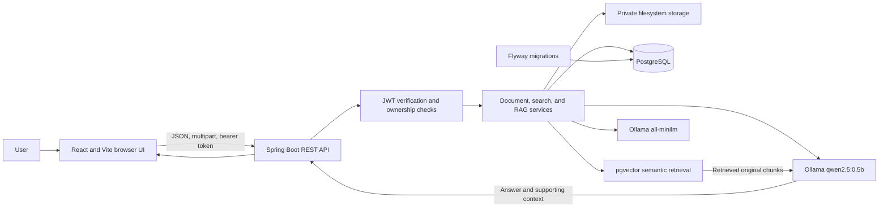

# Intelligent Document Analytics Hub

A full-stack document workspace for extracting, organizing, searching, and asking questions about personal PDF, DOCX, and TXT files. Semantic retrieval uses PostgreSQL with pgvector; question answering uses locally hosted Ollama models and returns the original retrieved context alongside the answer.

> **Project status:** Local development and evaluation application. This repository does not claim a production deployment.

## Overview

Finding information in long documents can require repeated reading and exact keyword searches. This application provides an authenticated workspace where an individual can upload a document, extract its text, create searchable passages and embeddings, and retrieve relevant context using natural-language queries. The Ask AI flow uses retrieved passages as input to a local language model and displays the passages supplied to it so the user can check the answer.

The project is intended for document owners, students, researchers, and teams evaluating private, document-grounded search workflows. It is not a general-purpose chatbot or a guarantee that generated answers are correct.

## Features

- Account registration, login, and current-account verification.
- JWT bearer authentication with BCrypt password hashing and server-side document ownership checks.
- A private personal workspace for uploading, listing, viewing metadata for, and deleting documents.
- PDF, DOCX, and UTF-8 TXT upload with file validation and a 10 MB per-file limit.
- Private file storage outside the repository by default.
- Text extraction, overlapping chunk generation, and embedding generation.
- PostgreSQL storage with Flyway-managed migrations and pgvector embeddings.
- Per-document semantic search with cosine-similarity scores.
- Retrieval-augmented question answering through Ollama, including original supporting context.
- Dashboard counts and recent-document activity derived from the user's document list.
- Light, dark, and system theme options; responsive homepage, authentication, and workspace layouts.
- Session restoration from tab-scoped browser storage after reload, verified against the backend; JWTs expire after 15 minutes.
- Input validation, request cancellation, safe user-facing errors, and explicit empty/loading states.

Document processing is user-triggered. Extraction, chunking, and embedding generation are separate steps. The UI does not claim a stage is complete without the available backend state.

## Technology stack

| Area | Technologies |
| --- | --- |
| Frontend | React 19, React Router 8, Vite 8, JavaScript, CSS |
| Backend | Java 21 target, Spring Boot 4.1.2, REST controllers, Maven Wrapper 3.10.0 |
| Database | PostgreSQL, pgvector, Spring Data JPA/JDBC, Flyway migrations V1–V8 |
| Document processing | Apache PDFBox 3.0.8, Apache POI 6.0.0 |
| AI | Ollama `all-minilm` embeddings (384 dimensions), `qwen2.5:0.5b` chat |
| Security | Spring Security OAuth2 resource server/JWT, HS256, BCrypt |
| Frontend tests | Node.js built-in `node:test` |
| Backend tests | JUnit 5 through Spring Boot test dependencies, with Spring MVC tests and Mockito-based tests |

Dependency versions are defined in [pom.xml](backend/pom.xml), [package.json](frontend/package.json), and [package-lock.json](frontend/package-lock.json).

## Architecture



### RAG workflow

1. Upload a document.
2. Extract its text.
3. Generate overlapping chunks.
4. Generate embeddings for those chunks.
5. Store embeddings in PostgreSQL with pgvector.
6. Submit a semantic search query or an Ask AI question.
7. Retrieve relevant chunks from the selected, owned document.
8. For Ask AI, pass bounded retrieved context to the Ollama chat model.
9. Display the answer and original supporting context for user verification.

Ask AI uses a conservative relevance threshold and may decline to answer. Its source list is the context supplied to the model, not verified sentence-level citations.

## Project structure

```text
backend/
  .mvn/wrapper/                 Maven Wrapper configuration
  mvnw.cmd
  pom.xml
  src/main/java/com/documentanalytics/backend/
    config/ controller/ dto/ entity/ exception/ repository/ service/
  src/main/resources/
    application.properties
    db/migration/               Flyway V1–V8
  src/test/java/                JUnit tests
frontend/
  public/
    images/                     Authentication illustrations
  src/
    components/                 Navigation, document search, Ask AI, shared UI
    context/                    Authentication and theme state
    pages/                      Home, login, registration, dashboard, documents
    styles/                     Global, marketing, and workspace styles
    utils/                      Document API and workflow helpers
  scripts/                      UI QA helper
  package.json
  package-lock.json
docs/
  api-reference.md
  architecture.md
  final-verification.md
  live-rag-verification.md
  rag-reliability.md
  setup-guide.md
  submission-checklist.md
README.md
```

## Prerequisites

- **Java:** JDK 21 is the configured compilation baseline (`java.version=21`).
- **Maven:** Use the checked-in Maven Wrapper; its configuration selects Maven 3.10.0.
- **Node.js:** Vite 8 requires Node `^20.19.0` or `>=22.12.0`.
- **npm:** Use the npm version bundled with a supported Node installation.
- **PostgreSQL:** A local PostgreSQL server and the pgvector extension are required. The application does not pin a PostgreSQL server version; the Windows setup guide documents the existing PostgreSQL 18 installation.
- **Ollama:** A local Ollama server with `all-minilm` and `qwen2.5:0.5b` available is required for embedding and Ask AI operations.

## Windows PowerShell setup

### 1. Clone and install frontend dependencies

```powershell
git clone https://github.com/sameeramadhushan2003-del/Intelligent-Document-Analytics-Hub.git
Set-Location -LiteralPath 'Intelligent-Document-Analytics-Hub'
Set-Location -LiteralPath '.\frontend'
npm.cmd ci
```

### 2. Configure PostgreSQL

Create or use an authorized PostgreSQL database and application role, and install pgvector for that PostgreSQL installation. The default JDBC URL is `jdbc:postgresql://localhost:5432/document_analytics_hub`; the configured role is `document_hub_app`. Do not recreate an existing database or reset an existing role.

Flyway applies pending V1–V8 migrations during normal Spring Boot startup. Migration V7 enables pgvector; the extension files must already be installed. Hibernate schema auto-update is disabled.

### 3. Configure private backend environment variables

Set these variables in the same private PowerShell session that launches Spring Boot:

| Variable | Required | Purpose |
| --- | --- | --- |
| `DB_PASSWORD` | Yes | Password for the authorized PostgreSQL application role |
| `JWT_SECRET_BASE64` | Yes | Stable Base64-encoded HS256 signing key, at least 32 decoded bytes |
| `DOCUMENT_STORAGE_DIR` | No | Private upload directory; defaults to `${user.home}\DocumentAnalyticsHub\private-uploads` |
| `OLLAMA_BASE_URL` | No | Ollama URL; defaults to `http://localhost:11434` |

Spring Boot does not load a repository `.env` file automatically. Do not commit credentials, place them in frontend `VITE_*` variables, or change the JWT key on every restart; a changed key invalidates existing tokens. For secure PowerShell prompts, fresh-database details, and pgvector installation, follow the [Windows setup guide](docs/setup-guide.md).

### 4. Start services

Start PostgreSQL and Ollama first. Pull the models if they are not already installed:

```powershell
ollama pull all-minilm
ollama pull qwen2.5:0.5b
# Start this only if Ollama is not already running as a service.
ollama serve
```

In another terminal, with the private backend environment already configured:

```powershell
Set-Location -LiteralPath '.\backend'
.\mvnw.cmd -B compile
.\mvnw.cmd spring-boot:run
```

In another terminal:

```powershell
Set-Location -LiteralPath '.\frontend'
npm.cmd run dev
```

The Vite development server proxies `/api` requests to `http://localhost:8080`. If port 5173 is occupied, Vite may choose another port; the backend CORS configuration currently allows `http://localhost:5173`.

## Local application URLs

| Service | Default URL |
| --- | --- |
| React/Vite | `http://localhost:5173` |
| Spring Boot API | `http://localhost:8080/api` |
| Health endpoint | `http://localhost:8080/api/health` |
| Ollama | `http://localhost:11434` |

The health endpoint reports the web application status; it is not a readiness check for PostgreSQL, pgvector, embeddings, or Ollama.

## REST API overview

Protected endpoints require `Authorization: Bearer <JWT>`. User identity is taken from the verified JWT subject, not a request-supplied user ID. All document operations enforce ownership.

| Method | Endpoint | Request | Result |
| --- | --- | --- | --- |
| `GET` | `/api/health` | None | Health status |
| `POST` | `/api/auth/register` | JSON: `fullName`, `email`, `password` | `201`; registered account metadata |
| `POST` | `/api/auth/login` | JSON: `email`, `password` | JWT and account metadata |
| `GET` | `/api/auth/me` | Bearer JWT | Verified current account |
| `POST` | `/api/documents/upload` | Multipart form part `file` | `201`; document ID and upload status |
| `GET` | `/api/documents` | Bearer JWT | Owned document metadata array |
| `GET` | `/api/documents/{documentId}` | Bearer JWT | Owned document metadata |
| `DELETE` | `/api/documents/{documentId}` | Bearer JWT | `204` after deletion; `202` if post-commit file cleanup remains pending |
| `POST` | `/api/documents/{documentId}/process` | Bearer JWT; no body | Extracted-text metadata |
| `POST` | `/api/documents/{documentId}/chunks/generate` | Bearer JWT; no body | Generated chunk count |
| `POST` | `/api/documents/{documentId}/embeddings/generate` | Bearer JWT; no body | Generated embedding count |
| `POST` | `/api/documents/{documentId}/search` | JSON: `query`, optional `limit` | Ranked chunks and similarity scores |
| `POST` | `/api/documents/{documentId}/ask` | JSON: `question` | Answer, model name, and supporting context |

The detailed [API reference](docs/api-reference.md) documents request and response examples, validation, and status codes. The API does not currently expose document download, token refresh, streaming chat, or multi-document conversations.

## Security

- Stateless Spring Security validates HS256 JWT signature, issuer, expiration, and a positive numeric subject.
- BCrypt hashes passwords; the frontend token is stored in tab-scoped `sessionStorage` and re-verified against `/api/auth/me` on restoration.
- The backend uses the JWT subject for account identity and checks document ownership before access and processing.
- Upload validation checks supported file types and size; uploaded files are stored under a UUID-based private storage key outside the repository by default.
- Database credentials and the JWT signing key are required from environment variables, not committed defaults.
- Spring MVC error responses are configured not to include internal exception details.

These are implementation details, not a penetration-test result or a claim that the system is production-hardened. See [RAG reliability and security notes](docs/rag-reliability.md).

## User interface

- **Homepage:** Product overview, interactive workflow preview, feature information, and FAQs.
- **Login and registration:** Responsive themed forms using the provided light/dark illustrations.
- **Dashboard:** Counts and recent activity derived from the user's document records.
- **Document workspace:** Upload, process, chunk, embed, search, Ask AI, and delete controls.
- **Semantic search and Ask AI:** Per-document results; Ask AI responses include expandable source context.
- **Themes and responsive layout:** Light, dark, and system preference support across public and authenticated pages.

## Screenshots

There are no verified application screenshots in `docs/screenshots/` at this time. The files under `frontend/public/images/` are authentication illustrations, not screenshots, and are not presented as product captures.

Suggested screenshots to add after a real run:

- [ ] Homepage in light and dark themes.
- [ ] Dashboard and document library using synthetic data.
- [ ] Upload and processing states for a synthetic document.
- [ ] Semantic search results with synthetic passages.
- [ ] Ask AI answer with expanded synthetic source context.
- [ ] Mobile-width workspace.

Remove personal document names, email addresses, tokens, browser headers, and private filesystem paths before publishing screenshots.

## Testing and validation

Frontend, from `frontend`:

```powershell
npm.cmd run build
npm.cmd run lint
npm.cmd test
```

Frontend tests use Node's built-in `node:test` runner. Backend compilation and the selected database-independent regression suite can be run from `backend`:

```powershell
.\mvnw.cmd -B compile
$selectedTests = @(
  'AuthInputValidationTest',
  'DocumentSecurityIntegrationTest',
  'PrivateFileStorageServiceTest',
  'DocumentDeletionServiceTest',
  'DocumentEmbeddingPersistenceServiceTest',
  'DocumentChunkEmbeddingRepositoryTest',
  'DocumentSemanticSearchRepositoryTest',
  'DocumentRagAnswerControllerTest',
  'DocumentRagAnswerServiceTest',
  'OllamaChatServiceTest',
  'DocumentProcessingServiceTest',
  'DocumentChunkingServiceTest',
  'DocumentChunkPersistenceServiceTest',
  'DocumentTextExtractionServiceTest',
  'OllamaEmbeddingServiceTest'
) -join ','
.\mvnw.cmd -B "-Dtest=$selectedTests" test
```

This selected suite uses synthetic inputs and mock data access so it does not require modifying a developer database. The live Ollama tests are opt-in and require local models. Database integration tests require a separately provisioned test database; do not run database-writing tests against personal data. See [final verification](docs/final-verification.md) for the latest recorded scope and results.

**Verified on 2026-11-01:** backend compilation passed; the selected backend suite reported **92 tests, 90 passed, 0 failed, 2 skipped** (optional Ollama integration tests). Frontend build and lint passed; `npm test` reported **32 passed, 0 failed**. These checks do not certify a fresh database installation or authenticated live end-to-end workflow.

## Limitations

- Ollama and its local models must be installed and running for embeddings and answer generation; CPU inference may be slow. The small chat model is intended for local evaluation, not high-throughput use.
- Answers can be incorrect or incomplete. Retrieval depends on the document, chunking, embeddings, query wording, and an initial relevance threshold that has not been universally calibrated.
- Supporting sources show original retrieved context; they are not guaranteed sentence-level citations or proof of entailment.
- OCR for scanned PDFs, antivirus scanning, streaming responses, refresh tokens, and global inference rate/admission controls are not implemented.
- Prompt instructions and conservative output checks reduce some unsupported answers but cannot eliminate hallucination or prompt-injection influence.
- This repository contains local-development configuration, not a production deployment, operational monitoring setup, or production security certification.

## Future improvements

Potential future work includes OCR, broader relevance evaluation, improved answer verification, resource-aware inference admission control, isolated database integration tests, and measured indexing/performance improvements. These are proposals, not existing features.

## Troubleshooting

| Symptom | Checks |
| --- | --- |
| PostgreSQL authentication failure | Confirm the database, role, and privately supplied `DB_PASSWORD`; do not reset existing accounts. |
| Missing environment variable | Set `DB_PASSWORD` and `JWT_SECRET_BASE64` in the same process environment that starts Spring Boot. |
| JWT key error | Use stable Base64 data that decodes to at least 32 bytes; changing it invalidates issued tokens. |
| Flyway cannot create `vector` | Install pgvector for the same PostgreSQL server before migration V7 runs. |
| Ollama connection/model error | Start the local Ollama service and verify both required model tags are installed. |
| Embeddings are missing | Run extract → generate chunks → generate embeddings for the owned document before search/Ask AI. |
| 401 response | Sign in again; confirm the token has not expired and the configured signing key is stable. |
| 404 document response | The document may not exist or may not belong to the authenticated account. |
| Vite proxy error | Confirm Spring Boot is listening on port 8080 and the frontend uses its configured origin. |
| Port already in use | Stop only the service you own or configure a free port; keep the frontend origin consistent with backend CORS. |
| PowerShell blocks `npm` | Use `npm.cmd`; do not weaken the machine execution policy for this project. |

## Documentation

- [Windows setup guide](docs/setup-guide.md)
- [Architecture diagrams](docs/architecture.md)
- [REST API reference](docs/api-reference.md)
- [Final verification report](docs/final-verification.md)
- [Live RAG verification procedure](docs/live-rag-verification.md)
- [RAG reliability notes](docs/rag-reliability.md)
- [Submission checklist](docs/submission-checklist.md)
