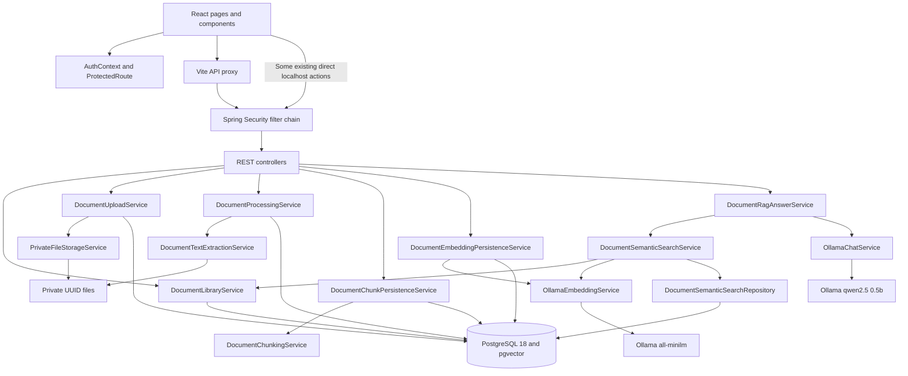
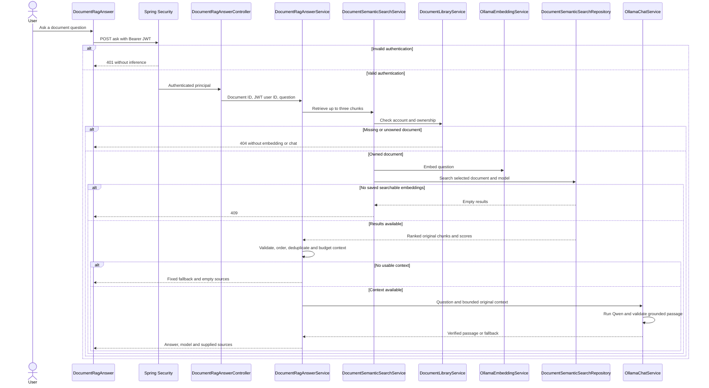

# Architecture

This describes the implemented development system. It does not describe a production hosting platform. Read [setup](setup-guide.md), [API reference](api-reference.md), and [RAG reliability](rag-reliability.md) for commands and constraints.

## Components

Frontend `App.jsx` defines home, registration, login, protected dashboard and protected documents routes. `DocumentSemanticSearch` displays ranked text; `DocumentRagAnswer` displays answers and expandable supplied context. `ragAnswerRequest.js` handles HTTP/response validation. The verified JWT session persists in tab-scoped `sessionStorage` and is revalidated by `/api/auth/me` on refresh; the visual theme preference is a separate, non-sensitive local-storage value. `ThemeProvider` resolves light/dark/system mode and applies `data-theme`; a small document-head bootstrap applies the saved/system palette before the app's first paint. A client-side route guard is a usability measure; the API independently enforces authorization.

`SecurityConfig` supplies stateless Bearer JWT authentication, HS256 encoder/decoder, issuer/time validation and positive numeric subject/expiry requirements. Public routes are `GET /api/health`, `POST /api/auth/register` and `POST /api/auth/login`; document routes require authentication. `TokenService` issues 900-second tokens. `AuthService` authenticates active accounts; `RegistrationService` uses BCrypt and normalized email addresses.

`DocumentLibraryService` checks account status and uses owner-filtered repository methods. Processing, chunking, embedding and search services invoke it before private work. Mutating document operations acquire a pessimistic lock on the owned document row so a concurrent delete cannot race extraction, chunk generation, or embedding persistence. The JWT subject is the sole source of the authenticated user ID. Missing and unowned documents both produce safe not-found responses.

## Storage and processing

`DocumentUploadService` validates the account, delegates file validation/storage, and persists metadata. `PrivateFileStorageService` chooses a UUID filename under the configured private root, checks streamed size and content, and computes SHA-256. Internal storage keys and password hashes are not exposed by document response DTOs. `DELETE /api/documents/{id}` resolves ownership from the verified JWT subject, stages the original file under a private `.pending-delete-*` name, and deletes document metadata in one database transaction. PostgreSQL foreign-key cascades remove extracted text, chunks, and embeddings. On rollback, the staged file is restored; only after commit is it unlinked. If post-commit unlinking fails, the request returns `202 Accepted` with a cleanup-pending result because metadata deletion is committed, the residual file stays quarantined and inaccessible by document ID, and the server logs the failure for operator cleanup. No migration is needed.

`DocumentTextExtractionService` reads canonical UUID files, refuses symlinks and applies file/text limits. PDFBox handles PDFs, POI handles DOCX, and strict UTF-8 decoding handles TXT. It does not perform OCR. `DocumentProcessingService` stores the extraction and marks the document `EXTRACTED`. `DocumentChunkingService` uses 1000-character chunks with 150-character overlap; `DocumentChunkPersistenceService` saves generated chunks. Regeneration can change derived records and should not be used for read-only checks.

`DocumentEmbeddingPersistenceService` processes chunks sequentially using `OllamaEmbeddingService`, reuses vectors already stored for the selected model, and holds the owner-scoped document lock so a concurrent delete cannot race persistence. Ollama requests are globally limited to one at a time with bounded connect, response, and queue-wait times. Upstream unavailability, invalid vectors, and timeouts map to safe 503, 502, and 504 responses; persistence failures are rolled back and logged without exposing SQL details to clients. `DocumentChunkEmbeddingRepository` parameterizes vector inserts keyed by chunk/model and preserves an existing vector on conflict. `all-minilm` produces 384 dimensions. `DocumentSemanticSearchRepository` parameterizes per-document cosine-distance search and converts scores to `1 - distance`; NULL distance becomes invalid rather than perfect similarity.

Flyway V1–V8 create `documents`, `app_users`, `document_extractions`, `document_chunks`, pgvector, and `document_chunk_embeddings`, plus ownership/storage constraints and indexes. Hibernate does not create/update tables. The embedding column is a pgvector `vector` with dimension consistency constraints, not a separately provisioned vector database. The current migrations define no ANN index; retrieval is exact and filtered to one document.

## RAG sequence

The sequence's early error arrows summarize propagated HTTP responses; services do not directly call the browser. Retrieval scores below 0.20 or invalid metadata are excluded. Context contains full original chunks only and must fit the shared byte budget. Qwen is bounded to 4096 context tokens and 160 output tokens; it is unloaded after each request. The byte budget is conservative, not an exact tokenizer measurement.

Answers are extractive: generated passages must appear in context after case/whitespace normalization. A verified quoted passage may be recovered from surrounding paraphrase, but unsupported standalone paraphrases remain rejected. Matching text does not prove relevance or truth. Prompt injection safeguards are not guarantees.

## Sources, errors and execution limits

The RAG JSON remains `documentId`, `question`, `answer`, `model`, `sources`. Each source carries an actual chunk ID/index, original text and score. Labels are application-generated in supplied order; no generated citation is used to invent metadata. Sources disclose model context, not verified sentence-level evidence. When Qwen declines after receiving context, that context can remain visible.

`DocumentRagExceptionHandler` scopes fixed safe errors to the RAG controller. Spring Security handles invalid JWTs before controller execution. Default error settings suppress internal details. React renders source/answer strings as escaped text and maps HTTP statuses to safe guidance.

The interface locks duplicate submissions synchronously and aborts requests on panel close or document/session change. Aborting the browser request does not guarantee immediate cancellation of server inference. There is no global heavy-inference queue/rate limiter or production-scale performance claim. Current automated/live/manual evidence and remaining checks are in [final verification](final-verification.md).
